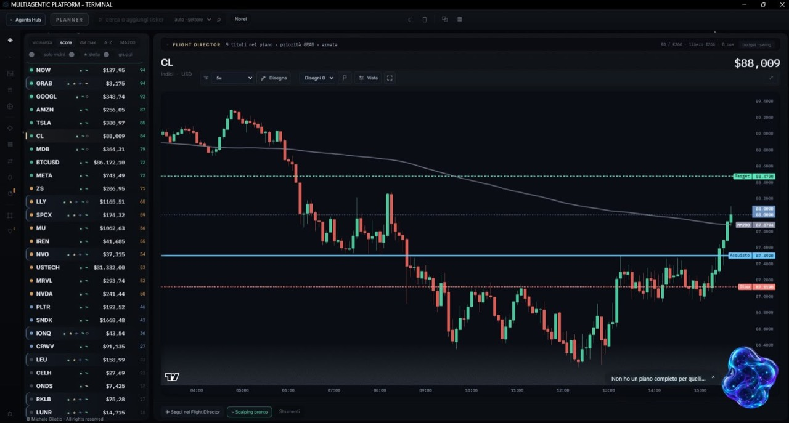

# Multiagentic Platform

**Windows trading software for your own live broker account**

[Download for Windows](#download) · [Installation guide](docs/INSTALLATION.md) · [Hugging Face Space](https://huggingface.co/spaces/Magic51/multiagentic-platform) · [Platform dossier](docs/ARCHITECTURE.md) · [SPINS](docs/SPINS.md) · [Scalping Lab](docs/SCALPING_LAB.md) · [VESPER](docs/VESPER.md) · [Support development](#support)

Multiagentic Platform is the first publicly released specialised application of the broader multiagentic systems programme developed by Michele Giletto at System Labs. This Windows trading application develops the Reasoning Agent into a coordinated environment for market analysis, portfolio allocation and authorised broker execution. Users connect their own compatible live broker accounts so that agents and native services can work with account observations, market quotes, positions, exposure and proposed decisions within a common operating context.

The underlying programme concerns the coordination of specialised software agents across different application domains: task contracts, scoped context, permissions, resource admission, action evidence and state reconciliation. Trading is its first public product application. Integration of the same architectural approach into Orbital is planned; it is separate from the capabilities delivered by this trading release. The [shared technology overview](https://giletto-systems-lab.michele-giletto.chatgpt.site/projects/multiagentic-systems) and [multiagentic systems dossier](docs/MULTIAGENTIC_SYSTEMS.md) explain this relationship and its current development status.

The installed implementation combines native analytical services, SPINS model components, broker adapters and explicit execution controls. Inspected adapters cover Capital.com, IG and OANDA, with different levels of recorded operational qualification as detailed below. Optional LLM integration code is present; the inspected build selects `NATIVE_ONLY` and disables those paths. Shipped SPINS artifacts are linked to documented local CPU training runs for synthetic instruction-policy imitation. That training evidence concerns the learned instruction policies; account and market observations come from the connected broker. VESPER is a complementary research track for inference under memory and I/O constraints.

**Public release version: 1.1.25.** The Windows distribution starts with an empty Agents Hub and supports onboarding for each user's own live broker account. Users supply their own broker credentials and explicitly authorise account access and trading operation. No broker credentials or developer account are preconfigured, and installation does not start automatic trading. An observer path is available before connecting an account.

Installed build **1.1.25-rc.49** was inspected statically on **19 October 2026**, alongside training, software-verification and passive operational records. That identifier identifies the historical evidence reviewed. The public **1.1.25** distribution has a separate [package and isolated QA record](docs/releases/1.1.25/TEST-RESULTS.json), including 64 passing compiled tests with mock clients. Neither review establishes new live-broker qualification. The installer contains compiled/minified runtime resources and essential SPINS inference weights under a proprietary binary licence; original development sources, source maps, trainers, datasets and private operational records are excluded.

## Download

[Download Multiagentic Platform 1.1.25 for Windows](https://github.com/michelegiletto-beep/multiagentic-platform/releases/download/v1.1.25/MultiagenticPlatform-Setup-1.1.25.exe) · [Release notes](docs/releases/1.1.25/RELEASE-NOTES.txt) · [Installation guide](docs/INSTALLATION.md)

Requires **Windows 10 or 11 x64**, Microsoft Edge, .NET Framework 4.8 and Windows PowerShell. Node.js is included; no Python, GPU, OpenAI key or previous installation is required. The installer runs per user without an administrator request. Internet access and personal broker credentials are required when connecting a broker.

| Installer | Verified delivery metadata |
| --- | --- |
| File | `MultiagenticPlatform-Setup-1.1.25.exe` |
| Size | 84,921,344 bytes |
| SHA-256 | `0fbafa46452a4c9bac3a53c395d778ec50c4312f82119cada7078d25ec9e608b` |
| Authenticode | `NotSigned`; no publisher certificate is included. |

Read the [binary licence](docs/releases/1.1.25/LICENSE.txt) and [known limitations](docs/releases/1.1.25/KNOWN-LIMITATIONS.txt) before installation. Check the downloaded file's SHA-256 against the value above. GitHub's **Download ZIP** downloads the documentation repository; the installer is the `.exe` linked above. File provenance and package-test scope are recorded in the [release record](docs/releases/1.1.25/README.md).

## Interface

Developer-supplied interface screenshot showing an instrument list, a candlestick workspace and an agent companion. Displayed prices and chart levels are screen content, not live data or measured strategy performance. Broker integration status is described in the evidence table below.

The terminal's Scalping workspace presents instruments, quote freshness, positions, orders and recent activity. **SCALPING LAB 2.2.6** is a separate offline research package for historical-data quality, campaigns, static-versus-adaptive comparisons, replay and simulated results. Its [research workflow](docs/SCALPING_LAB.md) is distinct from the terminal's operational workspace.

## Technical scope

The inspected implementation separates these responsibilities:

| Component | Responsibility |
| --- | --- |
| Statistical and neural components | Load versioned analytical and SPINS model artifacts; final activation and validation gates remain explicit. |
| Specialist agents | Perform bounded market analysis and portfolio decision tasks, exchanging structured results. |
| Optional LLM supervision | Produce scoped explanations or structured proposals; disabled in the inspected native-only build. |
| Deterministic control layer | Apply permissions, portfolio exposure limits, admission rules and execution checks. |
| Broker adapters | Translate authorised execution requests into provider-specific order and account semantics. |
| Audit and recovery services | Preserve trading decision context, reconcile portfolio and execution state, and support controlled recovery. |

The engineering difficulty lies in the interaction of temporal learning, changing portfolio state, heterogeneous agents, inference costs and execution reliability. A model that fits historical data does not by itself establish a useful allocation policy. A coherent agent plan does not establish that an action is permitted, executable or correctly recorded. Evaluation must measure those interfaces as well as each component.

## Evidence and development status

| Statement | Evidence category | Current interpretation |
| --- | --- | --- |
| Public distribution 1.1.25 | Package integrity, compiled mock tests and isolated Windows QA | 64/64 compiled tests passed; installation, empty first launch, broker forms and uninstall checked in disposable namespaces. No new live-broker qualification. |
| Inspected build 1.1.25-rc.49 and native agent workflow | Source-inspected implementation | Historical installed package and implementation examined; no execution test in this audit. |
| SPINS — Special Instructions | Inspected artifacts and documented CPU training | Shipped model artifacts match training records; final gates remain. Synthetic policy imitation does not establish profit prediction. |
| SCALPING LAB 2.2.6 | Separate offline research implementation and campaign records | Includes inconclusive and non-baseline-beating results; no production promotion implied. |
| Optional LLM supervision and fallback controls | Source-inspected implementation | Code exists; LLM paths disabled by `NATIVE_ONLY`. Saturated failover remains unmeasured. |
| Capital.com | Inspected adapter and documented live observations | Latest recorded passive audit, 16 October 2026: feed continuity unresolved, with stale quotes and degraded diagnostics. |
| IG and OANDA | Inspected adapters and internal mock tests | Full live qualification and provider approval are not established. |
| VESPER resource-constrained inference | Published research design, RFC 0001 | No working full-model runtime or measured speedup established by that RFC. |

No parameter count, model depth, training scale, predictive accuracy, execution latency or investment return is claimed without a corresponding measurement record.

## Public architecture and evaluation

[Implementation status](docs/IMPLEMENTATION_STATUS.md) records the inspected builds and limits. [Architecture](docs/ARCHITECTURE.md) explains component boundaries. [Validation](docs/VALIDATION.md) defines the evaluation protocol. [SCALPING LAB](docs/SCALPING_LAB.md) covers offline experiments; [VESPER](docs/VESPER.md) covers inference research.

The public record includes the [platform overview](https://giletto-systems-lab.michele-giletto.chatgpt.site/reasoning-agent.html), [VESPER project](https://giletto-systems-lab.michele-giletto.chatgpt.site/projects/vesper.html) and [VESPER RFC 0001](https://giletto-systems-lab.michele-giletto.chatgpt.site/materials/VESPER_RFC_0001.md). These sources document the programme and its stated development status; they do not substitute for implementation inspection or independent testing.

## Support

[Contribute through PayPal](https://www.paypal.com/qrcodes/p2pqrc/UG8AQFP5LPVU2) to support independent development.

Contributions are voluntary and do not grant a software licence, product access, intellectual property rights, investment participation, promised returns or a support commitment. Commercial rights and services require a separate agreement.

## Evaluation, licensing and strategic discussions

Companies and technical partners may request a scoped evaluation, commercial licensing discussion or strategic acquisition discussion. An evaluation can begin with a defined use case, available evidence, a test environment and agreed acceptance criteria. Proprietary implementation material can be considered separately under agreed confidentiality terms.

Contact [Michele Giletto](mailto:michele.giletto@gmail.com?subject=Multiagentic%20Platform%20evaluation%20and%20licensing) for evaluation, licensing or acquisition enquiries.

## Copyright

© 2026 Michele Giletto. All rights reserved. Multiagentic Platform is proprietary software. The [binary licence](docs/releases/1.1.25/LICENSE.txt) permits installation and use through the application's official interfaces; original runtime components and SPINS inference weights remain proprietary. Public availability grants no open source licence to the implementation or models. See [COPYRIGHT.md](COPYRIGHT.md). Citation metadata is provided in [CITATION.cff](CITATION.cff).
