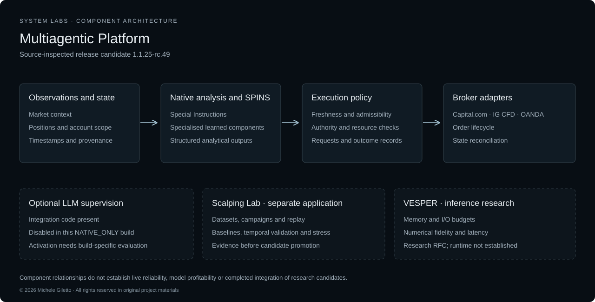

# Public architecture

Component overview; the disabled LLM paths and separate research applications retain their own validation status.

**Multiagent trading research and portfolio allocation**

This document describes the implementation boundaries reviewed on 19 October 2026: terminal release candidate 1.1.25-rc.49 and the separate SCALPING LAB package 2.2.6. Selected code and training, software-verification and passive operational records were reviewed without launching the application, contacting a broker or placing trades. Proprietary recipes and thresholds remain outside this account. [Implementation status](IMPLEMENTATION_STATUS.md) distinguishes implemented components from outstanding qualification.

## Product lineage and system boundary

Multiagentic Platform develops the Reasoning Agent programme into a shared trading research environment for specialist agents, numerical models and controlled actions. Its first application concerns equity-portfolio analysis and allocation. The public boundary includes market observations, analytical outputs, proposed trading decisions, execution controls and the evidence connecting them.

VESPER is a complementary inference research programme. It examines how a fixed model representation might be executed within explicit memory and I/O budgets when the complete weights cannot reside in fast memory. It is not the portfolio neural model, evidence of that model's parameter count or proof that the platform can already run a large model locally. The available VESPER RFC remains a research design.

## Trading research workflow

The implemented native workflow brings instrument observations together with positions, available capital and portfolio exposure. Specialist services contribute market analysis and structured evidence. Execution components consume scoped observations and proposals. Optional LLM integration is present in the code, while the inspected package selects native-only operation.

Execution controls evaluate a proposal within its current account and portfolio context before an adapter requests an external action. The code distinguishes a research proposal, an authorised request and a confirmed broker outcome. Static inspection establishes these implementation boundaries; it does not establish that every boundary behaves correctly in operation.

The terminal's Scalping workspace includes selected instruments, quote freshness, readiness, positions, orders and recent execution activity. Historical charts, grouping and filtering, and a compact monitor support observation across instruments. These interface components do not constitute evidence of measured strategy performance.

SCALPING LAB is a separate offline research package. Its dashboard covers historical-data quality, campaign progress, static-versus-adaptive comparisons, historical replay, walk-forward evaluation, stress conditions and simulated results. Candidate export is subject to research gates and does not automatically install a change in the terminal. [SCALPING LAB](SCALPING_LAB.md) describes that boundary and the recorded limitations.

## Why the system requires more than model inference

Market observations arrive through time and may be revised, delayed or absent. Portfolio state changes as actions are accepted, rejected or partially completed. Agents can produce individually coherent results that rely on different observations or incompatible assumptions. Inference also consumes finite memory, compute and service capacity.

These interactions create coupled correctness requirements. A prediction must use information available at its decision time. A proposed allocation must correspond to a known portfolio state. A task must have defined inputs, permitted tools and a deadline. An action must remain authorised when execution occurs. Resource management must preserve these conditions during degraded operation.

The relevant complexity is therefore temporal, statistical and operational. Public descriptions of model size alone cannot establish scientific merit, predictive validity or system reliability.

## Statistical and neural component

SPINS — Special Instructions — is represented in the installed package by model artifacts, engine code, readiness records and native runtime wiring. The aggregate manifest explicitly retains final gates. Its declared training domain is synthetic user-policy imitation, which concerns agreement with generated policy examples rather than market-profit probability.

The inspected model-selection implementation loads scoped artifacts, validates their declared schema and domain, and rejects fixture artifacts for production use. Deterministic defaults are present when a valid learned profile is unavailable or cannot be selected within its decision window. A profile is fixed for the relevant setup rather than silently changing during its lifecycle. These are source-inspected mechanisms, not measured quality or reliability results.

Offline training and dataset-export utilities are included. The inspected training code provides temporal splits, comparison of model alternatives and artifact integrity checks. Training reports document executed synthetic-policy fits, and artifact hashes link shipped SPINS models to documented local PyTorch CPU runs. The review did not rerun that training. Readiness and training records do not establish real-market validation or profit prediction.

The reviewed evidence does not substantiate a GPU training campaign linked to the installed models. Public descriptions therefore identify the documented CPU runs. Model internals, feature recipes and weights remain proprietary; a technical evaluation can assess them under an agreed disclosure boundary.

## LLM supervisory orchestrator

The installed source includes separate local-language and remote supervisory integration paths. The local companion works from scoped snapshots and structured facts to produce explanations. The remote supervisory path accepts structured proposals that are checked and compiled against current native context. Its output is not itself a confirmed external action.

The inspected compiler and caller code validate contracts, bind proposals to account and operation scope, and reject stale or incompatible context. Authoritative execution remains in the native worker. This separation provides an implemented boundary between semantic proposals and execution authority; its effectiveness still requires operational testing.

Release candidate rc.49 explicitly sets `NATIVE_ONLY`. Its supervisor suppresses LLM calls, does not start the local language-model service and disables the remote operator. The existence of optional integration code therefore does not mean that this inspected release operates under active LLM supervision.

LLM coordination can be evaluated for its contribution to interpreting heterogeneous evidence and selecting permitted tasks in a separately identified enabled condition. That evaluation must measure invalid proposals, changes in plan, resource costs and latency against the native reference workflow.

## Bounded autonomous and degraded operation

Autonomy is an operating envelope: a declared set of tasks, permissions, resources and recovery behaviours. Native operation is implemented independently of optional LLM services. The native controller contains a standard native path when optional supervision is disabled or unavailable.

The inspected LLM guard implements bounded queues, deadlines, cancellation, capacity deferral and fallback results. It checks backend availability and physical inference-slot release rather than treating transport cancellation alone as proof that compute has stopped. Companion responses also fall back when a result is unavailable, incomplete or inconsistent with current scoped state.

An LLM outage and numerical-service overload remain distinct failures. A fallback for the former does not establish equivalent learned-model quality or continued operation under every resource failure. Testing must establish which dependencies remain available and whether each condition leads to continued native work, deferral, reduced scope or abstention.

The presence of fallback code is verified by static inspection. Saturated failover timing, end-to-end continuity, state consistency and recovery were not measured in this audit. They require the fault-injection and reconciliation tests specified in the validation protocol.

## Broker adapter boundary

The installed implementation includes Capital.com, IG and OANDA adapters. Worker setup constructs the selected client, verifies its session and account context, and supplies it to execution components. The adapters implement provider-specific account, market-data and order-lifecycle operations behind a shared interface.

Capital.com code covers authentication, account binding, market and historical data, orders, positions, confirmations and streaming subscriptions. IG and OANDA implementations translate the shared interface into their native APIs and streaming mechanisms. Execution consumers distinguish acknowledgement from confirmed external state and contain reconciliation paths for uncertain outcomes.

Broker mutations are guarded by scoped dispatch authorisation. The inspected Capital.com client avoids automatically retrying ambiguous mutation requests. Credentials and operational account records were outside this review's disclosure scope. No broker request was issued by the audit.

The reviewed operational records document Capital.com live observations. The latest recorded passive audit, dated 16 October 2026, reports stale quotes despite a connected flag, diagnostic timeouts and degraded backend conditions. Feed continuity remains unresolved in that record; a verified fix is not established by the reviewed evidence.

IG and OANDA have implemented adapters and internal mock-test evidence, without full live qualification. A shared interface does not establish identical behaviour across instruments, accounts or brokers. Internal software checks also do not establish continuous feed freshness, live execution reliability or provider approval.

## Audit and recovery

The installed source includes scoped event, decision-journal and recovery components. Their interfaces distinguish proposals, decisions, execution requests and application receipts. An operational evaluation must establish whether the resulting record is complete and consistent across interruption and recovery.

Tests must establish how interrupted tasks, uncertain execution outcomes and stale permissions are handled against durable records and reconciled external state. The public validation protocol defines the evidence needed to evaluate those behaviours without disclosing proprietary algorithms.

## Relationship to VESPER

The platform and VESPER share a resource-management question: which work can be admitted and completed within an explicit operating budget? Their evidence remains separate. A portfolio prediction study cannot validate an inference runtime, and a memory feasibility result cannot establish portfolio performance.

VESPER's public work distinguishes memory capacity, numerical fidelity and response latency. Future integration would need to establish model compatibility, numerical correctness, resource accounting and service behaviour under actual platform workloads. The present RFC does not establish those integration results.
