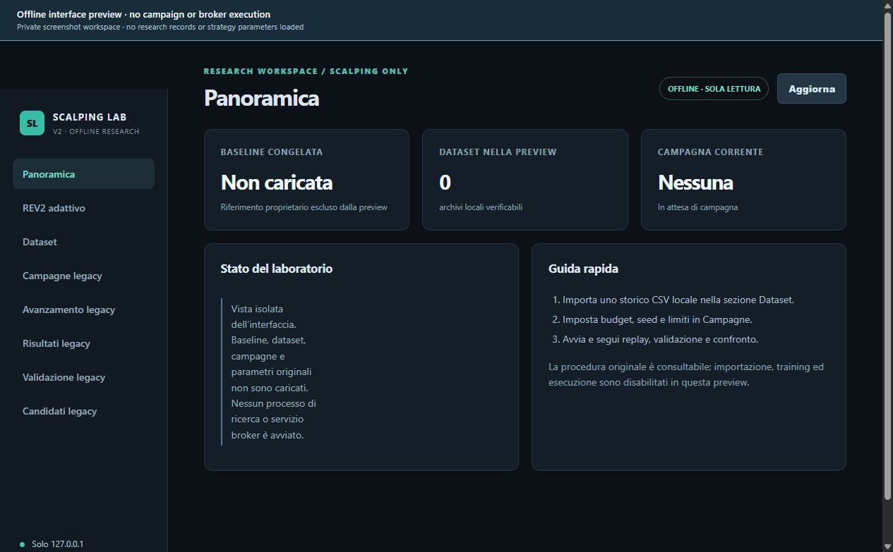
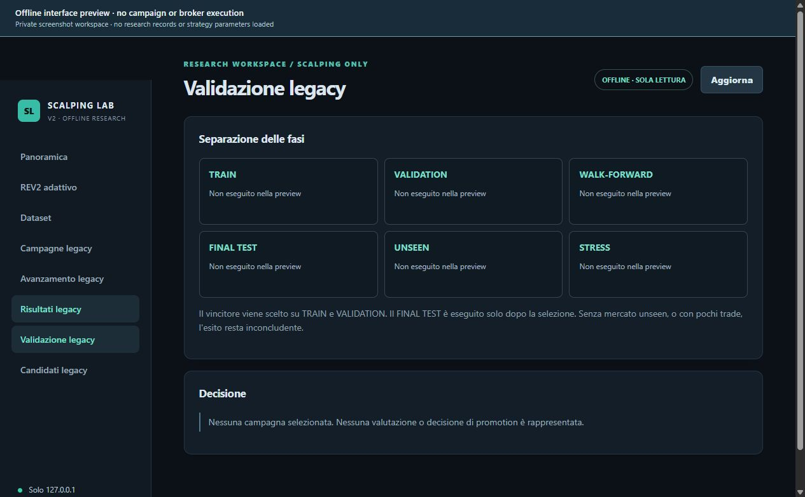

# SCALPING LAB

**Separate offline research package · Package version 2.2.6**

SCALPING LAB is an offline environment for evaluating changes to scalping engines through controlled historical experiments. It is separate from Multiagentic Platform's terminal Scalping workspace, which presents instruments, positions, orders and operational activity. The lab investigates candidate behaviour; the terminal manages an operating context and its authorised execution paths.

Package metadata identifies the reviewed lab as version 2.2.6. A retained historical README uses the earlier label 2.0.1. Neither label should be confused with the inspected historical terminal build 1.1.25-rc.49 or the version of a subsequently published terminal installer.

## Research workflow

The dashboard combines a catalogue of historical data with data-quality inspection, campaign control, replay progress and results. It supports comparison between a static baseline and adaptive candidates, together with simulated curves and the conditions governing research promotion.

The experiment workflow distinguishes training, validation, walk-forward evaluation, final testing, a separate market and stress conditions. Those stages have different roles: fitting a candidate, selecting among alternatives, examining temporal stability and challenging generalisation. A campaign record should identify which stages were completed and which remain unresolved.

Historical replay connects a candidate's decisions to observations available at each simulated decision time. Observed historical prices remain distinct from modelled costs, fills and execution. A simulated curve therefore represents the behaviour of a declared experiment under its assumptions; it is not a live account result.

## Comparisons and outcomes

An adaptive candidate requires comparison with its static baseline under the same data availability, cost assumptions, execution model and evaluation windows. A change in the simulation or data selection can alter a result independently of the candidate itself. Reporting must preserve those conditions so that a comparison can be assessed.

Reviewed campaign records include inconclusive outcomes and candidates that do not beat their baseline. The dashboard's ability to run or display an experiment does not establish an improvement. Negative and unresolved results remain material evidence about the candidate and the tested conditions.

Research promotion and candidate export are gated by evaluation outcomes. Export does not automatically install a change into the product or establish production deployment. A candidate that passes a laboratory gate still requires the intended operational environment, data feed, broker lifecycle and recovery behaviour to be qualified separately.

## Training and model provenance

The reviewed campaign evidence documents CPU execution. Separately, documented SPINS training runs use local PyTorch CPU execution, and hashes link shipped SPINS artifacts to their training records. These SPINS fits concern synthetic user-policy imitation; they do not measure market-profit probability. The lab and SPINS records should retain their respective experiment identities rather than being presented as a single training result.

No verified GPU campaign linked to the shipped models is established by the reviewed evidence. Training hardware claims require a corresponding run record, and model-performance claims require the relevant held-out evaluation.

## Interface previews

These captures use the actual frontend in an isolated preview. Original datasets, campaign records and proprietary settings are omitted; campaign actions and broker execution are disabled. The displayed stages are interface structure, not completed experimental results.

## Publication boundary

The public account describes the lab's functions and evidence boundaries. It excludes strategy recipes, proprietary thresholds, model weights, raw private campaign records and operational account details. The review considered existing implementation and records without rerunning campaigns or issuing broker requests.

[Implementation status](IMPLEMENTATION_STATUS.md) records the terminal, lab and provider limits. [Validation](VALIDATION.md) defines the separation between software checks, synthetic training, historical simulation and operational qualification.
